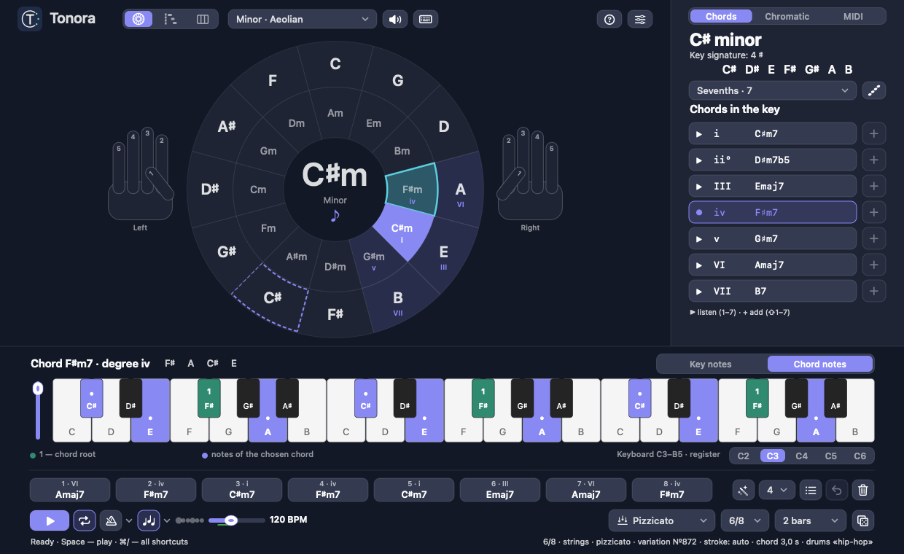

# Tonora

**English** | [Русский](README.ru.md)

An interactive circle of fifths for macOS. Pick a key on the circle, hear its chords, build a progression and play it back as block chords, a two-hand piano part, an arpeggio or a strings texture — then take it to your DAW as MIDI.

Native app for macOS 12 and later, Universal (Apple Silicon and Intel). The music core and the sampler are written in C11, the interface in Objective-C / AppKit. No third-party frameworks, no network access: all instruments are built in.



## Features

- **Circle of fifths.** The outer ring picks a major key, the inner ring its relative minor. Nine modes (major, natural minor, Dorian, Phrygian, Lydian, Mixolydian, Locrian, harmonic and melodic minor) and both pentatonics. Hover over another key to see the chords the two keys share and a way to modulate.
- **Chords of the key** from triads up to thirteenths, with degree numbers, the key signature and the scale. Listen with `1`–`7`, add with `⇧1`–`⇧7`.
- **Chords outside the key:** secondary dominants, chords borrowed from the parallel mode, tritone substitutes, the Neapolitan. Every chord explains where it comes from. Inversions from the chord's context menu.
- **Progressions.** An eight-slot sequence, a generator (`⌘N`) that writes new chords in the current key and mode, and ready-made progressions: pop, jazz, classical, minor.
- **Textures.** Block chords, a two-hand piano part in nine styles (ballad, Alberti, waltz, dark jazz, trip-hop, ambient…) with variations and fills, arpeggios in five patterns, and four strings textures (chorale, cantilena, ostinato, pizzicato).
- **Four instruments:** Salamander grand piano, Yamaha CP80, Hohner Pianet T and VSCO 2 strings with legato, spiccato, pizzicato and mod-wheel dynamics. Reverb and a tempo-synced delay.
- **Metronome and beats** to play along on a MIDI keyboard (`⌘K`): a click on beats, eighths, triplets or sixteenths, or a beat on a live drum kit — pop, ballad, bossa nova, shuffle, hip-hop, trip-hop, house, or one that suits the pattern's style. It runs on its own or locks to the sequence, with an optional one-bar count-in.
- **256-voice polyphony** with voice stealing, and a sustain pedal that lets a re-struck key ring.
- **Piano roll** to edit the generated part note by note: snap to grid, drag, stretch, quantize, undo, slowed-down playback.
- **MIDI everywhere.** Save a `.mid` file, drag a clip straight onto a DAW track, send notes live to the virtual «Tonora» port, play from a MIDI keyboard (one-key chords optional), or import a MIDI file — key, meter, tempo and chords are detected.
- **Learning aids:** animated hands with fingering, the computer keyboard as a piano (`M`), a help card with every shortcut and a page on how the circle works (`⌘/`).
- **English and Russian.** The interface follows the system language; switch it in the FX window (`⌘,`).

Everything — key, sequence, texture, sound, window position — is kept between launches.

## Install

Download `Tonora-<version>-universal.zip` from [Releases](../../releases), unzip it and move `Tonora.app` to Applications.

The app is signed locally, without an Apple Developer ID, so the first time macOS asks: right-click `Tonora.app` → **Open**.

## Build from source

You need macOS, Xcode command-line tools and CMake 3.20+.

```sh
./scripts/build.sh build-universal     # configure, build arm64 + x86_64, run the tests
open build-universal/Tonora.app
./scripts/package.sh                   # signed zip in dist/
```

The project also opens in CLion as a plain CMake project (target `Tonora`).

## Keyboard shortcuts

| Keys | Action |
|---|---|
| `←` `→` | neighbouring key on the circle |
| `↑` `↓` | major / minor on the same tonic |
| `⌥↑` `⌥↓` | previous / next mode |
| `1`–`7` · `⇧1`–`⇧7` | listen to a degree · add it to the sequence |
| `Space` · `Esc` | play / stop · stop |
| `T` · `L` | tonic · loop |
| `⌫` · `⌘←` `⌘→` | remove the selected chord · move it |
| `⌘↑` `⌘↓` | keyboard register |
| `⌘N` · `⇧⌘N` | new chords · extend the sequence |
| `⌘Z` · `⌘R` | bring back the previous sequence · new pattern variation |
| `⌘C` · `⇧⌘O` | copy the MIDI clip · import a MIDI file (or drop a `.mid` on the window) |
| `⌘O` · `⌘S` · `⇧⌘S` | open · save · save as a `.tonora` song file |
| `⌘1` `⌘2` `⌘3` · `⇧⌘A` | circle · piano roll · arranger · send the progression to the arranger |
| `⌘-click` · `⌘T` · `⌘D` | arranger: cut a section on a bar line · cut at the mouse · duplicate |
| `⇧⌘E` | export the song as MIDI |
| `⌘K` | metronome on / off (Esc stops it with the music) |
| `⌘,` · `⌘/` | sound and language · all shortcuts and help |
| `M` | play from the computer keyboard: `A`…`'` white keys, `W E T Y U O P` black keys, `Z X` octave, `C V` velocity |

## Project layout

| Path | What |
|---|---|
| `src/music.c` | keys, modes, spelling, chords and chord codes, explanations |
| `src/performance.c` | textures: two-hand patterns, arpeggios, strings, strokes |
| `src/fingering.c` | fingering for the animated hands |
| `src/mixer.c`, `src/piano.c`, `src/effects.c`, `src/audio.c` | 64-voice sampler, sample banks, reverb and delay, AudioQueue output |
| `src/midi.c`, `src/midiio.m` | MIDI files, CoreMIDI in and out |
| `src/main.m` | the window: circle, inspector, keyboard, sequence, FX, self-test |
| `src/pianoroll.m`, `src/controls.m` | piano roll; Tonora's own controls, glyphs and hover labels |
| `src/strings_en.m` | English interface strings (the Russian text in the code is the key) |
| `assets/` | instrument recordings with their licences and checksums |
| `design/` | specs, icon, logo, screenshots |
| `tests/` | core, sampler, texture, MIDI and fingering tests; the string-table check |

`ctest --test-dir build-universal` runs eight suites, including `Tonora --self-test`: the real window driven through 50 window sizes, both languages, playback, MIDI and saved settings, with its own settings store so your preferences are never touched.

## Sounds and credits

- **Salamander Grand Piano V3** — Alexander Holm, [CC BY 3.0](https://creativecommons.org/licenses/by/3.0/) · [source](https://github.com/sfzinstruments/SalamanderGrandPiano)
- **Yamaha CP80, Hohner Pianet T** — Greg Sullivan, [CC BY 3.0](https://creativecommons.org/licenses/by/3.0/) · [source](https://github.com/sfzinstruments/GregSullivan.E-Pianos)
- **Strings: VS Chamber Orchestra 2 Community Edition** — Versilian Studios (Sam Gossner, Simon Dalzell), CC0 · [source](https://github.com/sgossner/VSCO-2-CE)
- **Drums: Big Rusty Drums** — Karoryfer Samples, CC0 · [source](https://github.com/sfzinstruments/karoryfer.big-rusty-drums)
- **Percussion: Versilian Community Sample Library** — Versilian Studios, CC0 · [source](https://github.com/sgossner/VCSL)
- **Reverb: Verblib / Freeverb** — Philip Bennefall, Jezar at Dreampoint, public domain / Unlicense · [source](https://github.com/blastbay/verblib)

Compact subsets of the recordings are bundled. Full licence texts, authorship and SHA-256 manifests are in `assets/` and inside the app (Tonora → Instruments — authorship and licences).

Design notes and specs (in Russian) are in `design/`.
