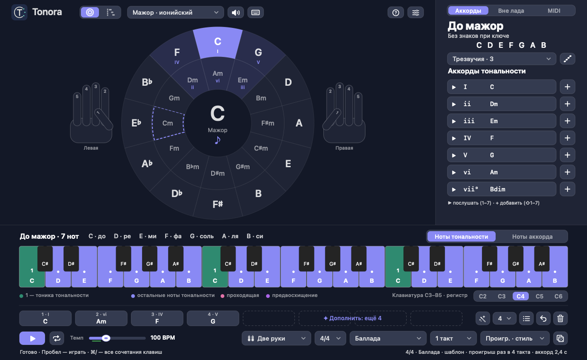

# Tonora

[English](README.md) | **Русский**

Нативный интерактивный квартоквинтовый круг для macOS 12 и новее. Сборка Universal содержит arm64 (Apple Silicon) и x86_64 (Intel). Музыкальное ядро и синтез звука написаны на C11, интерфейс — Objective-C / AppKit. Без сторонних библиотек и сетевых запросов.



## Установка

Скачайте `Tonora-<версия>-universal.zip` в [релизах](../../releases), распакуйте и перенесите `Tonora.app` в «Программы». Приложение подписано локально, без Apple Developer ID, поэтому при первом запуске откройте его правым щелчком → «Открыть».

Язык интерфейса — по системе (на русской macOS — русский, на любой другой — английский); переключатель «Язык · Language» — в окне FX (`⌘,`).

## Сборка и запуск

Нужны macOS, Xcode с выбранными developer tools и CMake.

```sh
./scripts/build.sh
open build/Tonora.app
```

Также можно открыть `CMakeLists.txt` в CLion и собрать цель `Tonora`.
Сборка создаёт обычный `.app`; его можно перенести в папку «Программы».
Текущая сборка предназначена для локального запуска, без нотариализации Apple.

## Управление

- Внешнее кольцо круга выбирает мажорную тональность, внутреннее — параллельную минорную; центр и кнопка с динамиком в шапке играют тоническое трезвучие.
- «Лад» в шапке: мажор, натуральный минор, дорийский, фригийский, лидийский, миксолидийский, локрийский, гармонический и мелодический минор. Тоника при смене лада сохраняется.
- Справа — инспектор: тональность с ладом, знаки при ключе, ноты гаммы, сложность гармонии (трезвучия … 13) и семь ступеней. ▶ — послушать, «+» — добавить в последовательность; кнопка с нотами справа от сложности гармонии играет гамму.
- Клавиша экранной клавиатуры звучит и горит, пока нажата мышь; протаскивание мышью по клавишам играет их по очереди.
- Клавиатура показывает ноты тональности или выбранного аккорда; регистр C2–C6 выбирается сегментом под клавиатурой.
- Последовательность — 8 слотов. Клик по аккорду — выбрать и послушать, перетаскивание — переставить, правый клик — меню. Во время игры звучащий аккорд подсвечен.
- Действия — иконки; подпись появляется пузырём при наведении (и читается VoiceOver). Текст остался там, где он сам значение: лад, сетка, размер, стиль, регистр.
- Транспорт: играть / стоп, повтор, темп (четверти в минуту), фактура (аккорды блоком, две руки, арпеджио), размер, стиль или рисунок арпеджио, длительность аккорда, проигрыши или длительности арпеджио, кубик — новая вариация.

Клавиши:

| Клавиши | Действие |
|---|---|
| `←` `→` | соседняя тональность |
| `↑` `↓` | мажор / минор на той же тонике |
| `⌥↑` `⌥↓` | предыдущий / следующий лад |
| `1`–`7` | послушать ступень |
| `⇧1`–`⇧7` | добавить ступень в последовательность |
| `Пробел` | играть / стоп |
| `Esc` | стоп |
| `T` | тоника |
| `L` | повтор |
| `⌫` | удалить выбранный аккорд |
| `⌘←` `⌘→` | переместить выбранный аккорд |
| `⌘↑` `⌘↓` | регистр клавиатуры |
| `⌘N` | новые аккорды (сколько — в списке рядом с кнопкой: 4, 6 или 8) |
| `⇧⌘N` | дополнить последовательность генерацией |
| `⌘Z` | вернуть последовательность |
| `⌘R` | новая вариация рисунка |
| `⌘O` | импортировать MIDI-файл (или перетащите .mid в окно) |
| `⌘/` | карточка со всеми сочетаниями (кнопка «?» в шапке, меню «Справка») |
| `M` | играть с клавиатуры компьютера: вкл / выкл |
| `A` … `'`, `W E T Y U O P` | ноты (при включённой клавиатуре компьютера) |
| `Z` `X` · `C` `V` | октава ниже / выше · сила −20 / +20 |

Тональность, лад, последовательность, все параметры исполнения, звук и размер окна сохраняются между запусками.

## Структура

- `src/music.c` — тональности, диатоническое написание нот, гаммы и трезвучия.
- `src/audio.c` — воспроизведение стерео через AudioQueue.
- `src/piano.c` — загрузка записей, интерполяция высоты, огибающие, системные эффекты Apple Reverb2 и AU Delay.
- `src/main.m` — окно AppKit, круг, два режима клавиатуры, сохранение состояния.
- `src/brand.m` — векторный знак «T» в незамкнутом круге с тремя нотами.
- `design/mark.svg`, `design/logo.svg` — редактируемые знак и логотип.
- `tests/music_tests.c` — проверки всех 24 тональностей.
- `design/concept.png` — согласованный визуальный концепт, созданный встроенным imagegen. Промпт: нативное светлое окно «Кварта», квартоквинтовый круг с параллельными минорами, инспектор гаммы и аккордов, клавиатура и последовательность.

`ctest --test-dir build --output-on-failure` запускает музыкальные проверки и интеграционную проверку нативного интерфейса, транспонирования, восстановления настроек и AudioQueue. Интеграционная проверка использует отдельные временные настройки и кратко воспроизводит тестовый звук.

Иконка содержит все стандартные размеры 16–1024 px и собрана системным `iconutil`. При запуске приложение также явно задаёт изображение Dock из ресурса `Tonora.icns`. Идентификатор пакета сохранён для совместимости с ранее сохранёнными настройками.

Универсальную сборку в отдельном каталоге можно получить командой `./scripts/build.sh build-universal`. Проверка архитектур: `lipo -archs build-universal/Tonora.app/Contents/MacOS/Tonora`.

После успешной сборки `./scripts/package.sh` проверяет обе архитектуры, ставит локальную ad-hoc подпись и создаёт `dist/Tonora-0.16.0-universal.zip`. Это подпись целостности, без Developer ID и нотариализации Apple; на другом Mac при первом открытии может понадобиться ручное разрешение в настройках безопасности. Архив содержит один `Tonora.app`, macOS выбирает нужную архитектуру автоматически.


## Пианино, эффекты и генератор

«FX» открывает выбор рояля / Yamaha CP80 / Hohner Pianet T / струнных, живого или ровного исполнения, реверберации, дилея и времени повторов (80–1200 мс). Эффекты изменяются в потоке с сохранением хвостов звука. Кнопка «Послушать» воспроизводит выбранный аккорд. Настройки сохраняются.

«Сгенерировать…» позволяет выбрать тональность и лад, характер («Поп», «Классика», «Спокойная»), 4 или 8 аккордов и темп 50–160 BPM. Генерация использует диатонические обороты и заменяет текущую последовательность. На аккорд отведено 2 доли. Для натурального минора сохраняется минорная V ступень; гармонический минор не добавляется автоматически.

На круге полупрозрачные сектора показывают входящие мажорные и минорные трезвучия, сплошной синий — выбранную тональность, бирюзовая обводка — рассматриваемый аккорд. Уменьшённое трезвучие подписано отдельно под кругом.

Источник пианино: https://github.com/sfzinstruments/SalamanderGrandPiano — Alexander Holm, Creative Commons Attribution 3.0. Полная лицензия, авторство и список исходных файлов с контрольными суммами находятся в `assets/piano/` и внутри приложения. Загрузить отсутствующие записи: `python3 scripts/fetch_piano.py`. Воспроизведение работает без интернета. Тест `piano_render` проверяет реальный сэмплер и эффекты, создавая `build-universal/piano-preview.wav`.


## Оформление, анимация и октавы (0.4)

Все кнопки, переключатели, списки выбора и ползунки имеют собственную отрисовку в `src/controls.m`, с состояниями нажатия, наведения, выбора и недоступности. Сохраняются нативные события, клавиатурное управление и accessibility.

Клавиши плавно опускаются и подсвечиваются при проигрывании гаммы и аккордов. Анимация использует позицию AudioQueue, а не отсчёт от нажатия кнопки; остановка и смена тональности сбрасывают активные клавиши. Учитывается системная настройка уменьшения движения.

Ползунок рядом с диапазоном клавиатуры и `⌘↓ / ⌘↑` перемещают две видимые октавы в диапазоне C2–B7. Они также транспонируют воспроизведение; крайние ноты возвращаются в диапазон фортепиано переносом на октаву. Выбранный регистр сохраняется.

`src/effects.c` использует только системные Apple Audio Units: Reverb2 (короткое пространство с затуханием 1.25 с на низких и 0.45 с на высоких частотах, задержкой отражений 18–45 мс) и AU Delay (feedback 22%, low-pass 4.2 кГц). Эффекты не используют прежнюю самописную сеть comb/all-pass. Уровень сэмплов снижен для запаса по пикам; защита только ослабляет чрезмерные пики и не увеличивает тихие записи. Обработка идёт блоками 512 с нулевым дополнением последнего блока. Тесты проверяют неизменность сухого звука, время повторов, затухание хвоста, отсутствие нечисловых значений и клиппинга.


## Потоковый движок и инструменты (0.5)

`src/mixer.c` — полифонический сэмплер на C с 64 голосами, плавной атакой и затуханием. Повторное нажатие той же ноты оставляет старый голос с 12-мс затуханием и добавляет новый с 4-мс атакой; предыдущий аудиофрагмент не обрывается. Одиночные ноты накладываются друг на друга, новая последовательность отменяет будущие события предыдущей и плавно освобождает её голоса. AudioQueue работает непрерывно с буферами по 256 кадров; нет декодирования, создания эффектов или выделения памяти в коде аудиоколбэка. Команды передаются через ограниченную очередь с одним производителем и одним потребителем. Фактическая задержка также зависит от аудиоустройства и macOS.

Пианино загружается до начала проигрывания. Все четыре инструмента встроены и работают без сети: Salamander Grand (17 записей), Yamaha CP80 (22 записи), Hohner Pianet T (16 записей), струнные VSCO 2 CE (160 записей: долгие ноты тихо и громко, спиккато и пиццикато; с 1.0.0, штрихи с 1.1.0). Электропианино записал Greg Sullivan, лицензия CC BY 3.0; авторство, полные лицензии и manifest с SHA-256 находятся в соответствующих папках `assets/` и в приложении. `python3 scripts/fetch_electric.py` восстанавливает электрические банки из закреплённой ревизии. Уровни электрических банков ослаблены для согласования с акустическим роялем.

Гуманизация включена по умолчанию и отключается в FX («Ровное»). Громкость каждой новой ноты меняется только в пределах 94–106% от базового уровня; ноты в аккорде разделены максимум на 4 мс, микротайминг событий — около ±5 мс, лёгкий свинг — до 12 мс на чередующихся событиях. Отклонения считаются относительно исходной временной сетки и не накапливаются. Первая нота ручного нажатия не задерживается гуманизацией.

Клавиши сразу реагируют на нажатие и слегка темнеют при наведении. Текущие ноты анимации берутся из голосов движка. Клик по сектору круга включает режим тональности и воспроизводит её тонический аккорд; центр тоже играет тонику. Клик по аккорду последовательности включает режим аккорда.

Дополнительный тест `realtime_mixer` проверяет непрерывность сигнала при повторном нажатии, полифонию, все три инструмента, потоковые эффекты, освобождение голосов и ограниченную живую динамику. Проверки нативного интерфейса завершаются обычным кодом ошибки при неуспехе, без вызова аварийного завершения приложения.

## 0.6.0

Короткий импульс клавиши: 65 мс удержания, спад 25 мс. Под кругом доступны все семь ступеней, включая уменьшённую. Темп применяется сразу: гамма восьмыми, последовательность по две доли на аккорд; изменение во время игры пересчитывает будущие события. Дилей синхронизируется с BPM: 1/4, 1/8, 1/16, пунктирная и триольная восьмая, либо свободные миллисекунды. FX используют параллельные 100% wet Apple AU возвраты с фильтрацией 180–4800 Гц, чистый сигнал сохраняется; защитное ограничение действует только выше 0.85.

## 0.7.0 — новый FX

Apple Delay и Reverb2 полностью удалены из обработки. Реверберация — Verblib 0.5 (Freeverb, Philip Bennefall, public domain / Unlicense), исходник закреплён в third_party/verblib; лицензия включена в приложение. Дилей — собственная стереолиния задержки на C с обратной связью 38%, фильтром в петле и перекрёстным затуханием 20 мс при смене времени. Первый повтор сохраняет полосу исходного звука; при уровне 28% его амплитуда составляет 36.4% от оригинала. Отдельные режимы «Доли» / «мс», ненужные поля скрыты. При первом переходе на новый движок выставляются реверберация 22% и дилей 28%; затем сохраняются пользовательские уровни. Офлайн-рендер и живое воспроизведение используют одну реализацию FX. Проблема субъективного соответствия темпа ползунку остаётся отдельной задачей.

## 0.7.1 — уровень реверберации

Исправлено двойное ослабление возврата Freeverb. Реверб теперь использует equal-power mix 0–100%, на 100% сухой сигнал выключается; увеличено время затухания и уменьшено демпфирование. На контрольной C4 при миксе 22%, без дилея: энергия возврата относительно сухой ноты −4.12 дБ (ранее −18.19 дБ), хвоста после отпускания −20.71 дБ (ранее −42.90 дБ). Тест проверяет уровень на реальном сэмпле, изолированный хвост, отсутствие сухой атаки при 100% и точное сохранение сигнала при 0%. Звуковой пример: сначала сухая нота, после паузы та же нота с 22% реверберации.

## 0.8.0 — воспроизведение и повтор

Темп находится в нижней строке воспроизведения (50–240 BPM), генератор создаёт только последовательность. Один аккорд занимает одну четвертную долю: 160 BPM = 375 мс, 80 BPM = 750 мс. Гамма звучит восьмыми. Переключатель «Повтор» работает в аудиомикшере, без таймеров интерфейса, с сохранением хвостов FX; темп можно менять во время игры. «Стоп» и Esc прекращают воспроизведение. Потеря фокуса больше не останавливает звук; на время игры приложение удерживает активность, предотвращающую App Nap (сон компьютера не блокируется). Тесты проверяют 32 цикла при 80/160 BPM, границы с точностью до сэмпла, изменение темпа внутри цикла и повтор без видимого окна. Закрытие последнего окна по-прежнему завершает приложение; сворачивание и скрытие — нет.

## 0.9.0 — Two-Hand Piano

Одна кнопка «Играть / Стоп» показывает фактическое состояние звука и останавливает его при повторном нажатии. Обычные аккорды сохраняют одну долю на аккорд. Новый выбор фактуры находится в строке воспроизведения: «Аккорды» или «Two-Hand Piano». Рисунки Ballad, Flowing, Alberti, Pop используют 4/4, Waltz — 3/4; один аккорд длится один такт, обе руки используют общую четвертную сетку BPM.

Левая рука играет басовые ноты, октавы, квинты и переборы; правая — арпеджио, разбитые аккорды и синкопированные созвучия. Верхние трезвучия выбираются среди компактных обращений с минимальным движением относительно предыдущего аккорда. Все ноты принадлежат текущему трезвучию, включая уменьшённые аккорды натурального минора и мажора. Партии сохраняют индивидуальные длительности и velocity, существующую хуманизацию, инструменты, FX, повтор, изменение темпа и фоновое воспроизведение. Нажатие отдельного аккорда в новом режиме играет один такт выбранной фактуры; одиночные клавиши и гамма сохраняют прежнее поведение. В Two-Hand Piano клавиатура расширяется до трёх октав для отображения обеих рук; обычный режим остаётся двухоктавным.

Существующий C-аудиомикшер расширен расписанием MIDI-высот, velocity и длительностей в долях (`performance.h`), экспорт/вывод на внешний MIDI-порт не добавлялся: такого транспорта в проекте не было. Новые библиотеки не добавлялись. Проверки: пять рисунков во всех 24 тональностях и пяти регистрах, независимые ритмы рук, принадлежность нот аккорду, сохранение общих голосов C→Am, границы тактов и повтор с точностью до сэмпла, смена темпа, сохранение настроек и возврат к обычным аккордам.

## 0.10.0 — тёмные мелодии и проигрыши

В существующий выбор Two-Hand Piano добавлены Dark Jazz, Trip-Hop, Slow Ambient (эмбиент / slowcore) и Interlude. Это фортепианные фактуры, не генератор ударных или готовых рэп-битов. Dark Jazz использует синкопы, септимы и ноны в тональности; Trip-Hop — смещённый бас и короткие мотивы с паузами; Slow Ambient — длинные ноты и разреженные партии; Interlude — переходные фразы с триольным движением и более частыми проигрышами. Подходящий исходный диапазон темпа — 60–95 BPM; установленный пользователем темп не изменяется.

Мелодия знает выбранную тональность, использует проходящие ступени за пределами трезвучия и развивает мотив через повтор, обращение и смену контура. Каждая четвёртая фраза и конец последовательности получают проигрыш с движением к следующему аккорду; в Interlude проигрыш есть в каждом такте. В Slow Ambient проигрыши остаются короткими и редкими. При каждом новом запуске выбирается вариант мотива, а внутри цикла он повторяется с существующей хуманизацией. Старые пять рисунков сохраняют прежние ноты и ритмы. Сетку темпа, повтор, FX и MIDI-высоты обслуживает прежний аудиомикшер.

## 0.11.0 — независимый рисунок и расширенные аккорды

В строке последовательности появились две независимые настройки: «↻ Рисунок» и гармония (трезвучия, 7, 9, 11, 13). Сложность гармонии применяется ко всем ступеням, их обозначениям, клавиатуре и воспроизведению; септимы и расширения строятся диатонически. Изменённые расширения подписаны b9, #11, b13. Звучат все выбранные ступени, а не только исходное трезвучие.

«↻ Рисунок» сохраняет аккорды и создаёт новое исполнение: независимые сетки рук, плотность, длительности, роль баса, направление верхней партии и переходные проигрыши. Рисунок определяется отдельным сохранённым seed, повторный запуск не меняет его. Генерация при запущенной последовательности перезапускает её с новым рисунком и прежней гармонией. Выбор именованного стиля возвращает его исходный фиксированный рисунок; кнопка снова генерирует вариацию в выбранном стиле. Исходные авторские рисунки с трезвучиями сохранены без изменений.

Проверки сравнивают фактические сетки вступления нот для разных seed, повторяемость результата, звучание всех расширенных ступеней, 24 тональности, повтор, сохранение настроек и независимость гармонии от генерации исполнения.

## 0.12.0 — ограничения музыкального рисунка

Убран случайный выбор отдельных вступлений нот. Генерация выбирает целую написанную ритмическую фразу, сохраняет её на два такта и строит ответ в следующих двух. Бас сохраняет одну фигуру на протяжении фразы; мелодия движется преимущественно поступенно с опорой на терцию и септиму. Проигрыш состоит из двух разрешающихся нот и заменяет окончание, а не накладывается поверх мелодии. В эмбиенте заполнения отключены.

Расширенная гармония больше не обязана излагаться всеми семью нотами в каждом такте: выбираются опорные голоса и одна краска, чтобы не превращать аккорд в плотную гамму. Обычное аккордовое воспроизведение сохраняет полную формулу. Механический контроль проверяет одноголосность лидирующей мелодии, скачки не больше квинты, ограниченную плотность и отсутствие тесных одновременных верхних голосов. Для новых контролируемых рисунков сокращён отпуск ноты, чтобы старые ноты не смазывали следующую; старые фиксированные стили сохраняют прежнюю артикуляцию. Эти правила отсекают технически неудачные фразы, но не являются автоматической оценкой музыкального вкуса.

## 0.15.0 — раскладка, транспорт и модель рисунка

ТЗ: `design/UX-TZ-0.15.md`, скриншоты до и после: `design/ux-audit/`.

**Раскладка.** Окно строится по сетке 8 pt без неравномерного масштабирования. С 0.16 размер окна фиксированный и рассчитан на MacBook: 1240×760, а если на экране под строкой меню и над Доком (в том числе скрываемым) не хватает места — 1120×680. Размер подбирается под экран, на котором окно находится, и пересчитывается при переносе окна на другой монитор; запоминается только положение. Чипы ступеней под кругом убраны — они дублировали инспектор. Последовательность — 8 слотов фиксированной ширины; имя аккорда уменьшает шрифт, а не обрезается. Ползунок октав заменён сегментом регистра. Self-test проверяет 50 комбинаций размеров окна (1120–1728 × 680–1000) и обе фактуры: нет пересечений, всё в окне, радиус круга ≥ 160, строки списка ≥ 28, подписи поп-апов и любое имя аккорда помещаются.

**Транспорт.** Темп везде означает четверти в минуту, длительность аккорда задаётся явно. Обе фактуры идут через одно расписание исполнения, поэтому переключение «Аккорды / Две руки» больше не меняет длину последовательности в 4 раза. Изменение лада, гармонии, фактуры, размера, стиля, длительности, проигрышей, вариации и регистра во время игры перезапускает последовательность с текущего аккорда. Смена стиля сохраняет режим вариации; «Шаблон стиля» и «Вариация №N» выбираются в меню стиля.

**Модель рисунка** (`kv_arrange_with`). Независимые параметры: размер 4/4, 3/4, 6/8; стиль (9 стилей, у каждого шаблон для каждого размера); длительность аккорда — 1 доля, 2 доли, 1 такт, 2 такта (в 6/8 доля — четверть с точкой); проигрыши — по стилю, нет, каждые 4, каждые 2, каждый такт. Проигрыш — короткий гаммообразный заход или двойной вспомогательный тон, разрешающийся на сильную долю следующего аккорда, либо подхват баса. Подряд не повторяет одну высоту, при превью одного аккорда не добавляется, ноты не короче 90 мс. Аккорд, начавшийся внутри такта, всегда отмечен басом. Старые функции `kv_two_hand` и `kv_arrange` сохранены без изменений. Тест ядра проверяет 31 104 комбинации стиля, размера, длительности, проигрышей, тональностей и расширений.

**Миграция.** Сохранённый в 0.14 «Waltz» в режиме двух рук открывается как «Вальс · 3/4»; остальные — 4/4. Блочные аккорды по умолчанию — 1 доля на аккорд, две руки — 1 такт.

Исходники 0.14.1 сохранены в `_backup-0.14.1/`.

**Круг от выбранной тональности.** Подписи круга строятся от текущей тональности: её аккорды пишутся так же, как в инспекторе (в ля-бемоль миноре — A♭m, D♭m, E♭, F♭, а не G♯m, C♯m, E), остальные чёрные клавиши — по направлению ключевых знаков (в бемольных тональностях бемолями, в диезных диезами, без знаков — привычные подписи круга); клавиатура подписывает ноты вне гаммы так же. Тонику лада заливает сектор её трезвучия; тот же тон на другом кольце (одноимённый мажор или минор) обведён пунктиром. Тональность запоминает букву тоники: клик по «A♭m» даёт ля-бемоль минор (7 ♭), а не соль-диез. Гармонический и мелодический минор показывают ключевые знаки натурального минора и отдельно — повышенные ступени.

**Тоника остаётся там, где её выбрали.** Нажатый сектор круга — тоника, и он остаётся выделенным в любом ладу; лад только меняет, какие аккорды подсвечены (с номерами ступеней). Если сам аккорд на тонике в ладу не встречается (A♭ мажор в ля-бемоль гармоническом миноре), сектор подписан «тоника», а тоническое трезвучие лада (A♭m, i) подсвечено и обведено пунктиром. Список «Лад» никогда не меняет тонику: «Минор» из ля-бемоль мажора даёт ля-бемоль минор, «Мажор» из него — снова ля-бемоль мажор.

**Новые аккорды в один клик.** Диалога генератора больше нет: кнопка ✦ в ряду последовательности (рядом с «Вернуть» и «Очистить»), ссылка в пустой последовательности, `⌘N` и пункт меню «Последовательность» сразу создают новую последовательность в текущей тональности и ладу. Длина — как у текущей (4 по умолчанию), клик с ⌥ переключает 4 ↔ 8. Характер оборотов выбирается по фактуре и стилю: поп для блоков, баллады, попа и трип-хопа; классические каденции для Альберти, вальса, дарк-джаза и интерлюдии; спокойное движение для перебора, эмбиента и арпеджио. ⌘Z возвращает прежнюю последовательность.

**Не больше семи знаков при ключе.** Запись тоники выбирается так, как её нажали на круге, пока у тональности не больше семи знаков (ля-бемоль минор с 7 ♭ сохраняется). Если лад требует восьми и более — ре-бемоль фригийский (9 ♭), ре-бемоль мелодический минор (8 ♭ при ключе), ре-диез лидийский (10 ♯) — берётся одноимённая запись с теми же клавишами (до-диез фригийский, 3 ♯), и строка знаков при ключе помечает: «вместо ре-бемоль (9 ♭)». Выбранная буква запоминается, так что после смены лада запись возвращается, как только снова укладывается в семь знаков. Гармонический и мелодический минор считаются по знакам натурального минора; повышенные ступени показаны отдельно. Проверка в тестах перебирает все 24 тональности × 8 ладов × 8 вариантов записи тоники: буквы гаммы идут подряд, знаки совпадают с высотой, имена аккордов и подписи круга согласованы, тройных знаков не бывает.

## 1.2.0 — английский язык, понятные фактуры и штрихи

Решения — в `design/UX-TZ-1.2.md`.

- **Английский интерфейс.** Язык по системе: на русской macOS — русский, на любой другой — английский. Переключатель «Язык · Language» — в окне FX (⌘, или кнопка FX); интерфейс и меню перестраиваются сразу, последовательность, звук и тональность сохраняются. Русские строки в коде — ключи `T(@"…")`, английский — в `src/strings_en.m`; тест `english_strings` не даёт оставить строку без перевода.
- **Фактуры в две группы** со значками: фортепианные (у любого инструмента) и струнные (у струнных); при рояле меню подсказывает, где струнные фактуры. Штрихи в FX со значками и строкой о том, что делает «Авто».
- **Звук по умолчанию** при первом запуске: рояль, две руки, реверб 10 %, дилей 10 % на 1/8; кнопка «По умолчанию» в FX.
- **Справка:** вкладка «Квинтовый круг» — что это за круг и почему всё строится от него.
- Исправлено: анимация и MIDI-выход не замирают, пока тянут ползунок; динамика струнных слышна и на коротких штрихах; подсказки не всплывают сквозь карточку справки и не двоятся над кругом.

## 1.1.0 — струнные: штрихи, легато, динамика, своя игра

Решения — в `design/STRINGS-1.1.md`. Пример звучания всех четырёх струнных фактур: `design/audio/strings-textures-preview.m4a`.

**Штрихи.** В FX у струнных появилась строка «Штрих»: Авто, Легато, Стаккато, Пиццикато.
- **Авто** (по умолчанию): нота короче восьмой играется спиккато; нота, которая начинается, пока звучит предыдущая той же руки, — легато; остальные — долгая нота новым смычком.
- **Легато:** ничего не укорачивается.
- **Стаккато и Пиццикато:** все ноты короткие.

У коротких штрихов сила нажатия выбирает тихую или громкую запись, а два дубля чередуются, чтобы повтор не звучал одинаково. Щипок звучит до конца, даже если клавишу уже отпустили. На MIDI-клавиатуре штрих переключают клавиши C1–D♯1 (MIDI 24–27): они ниже диапазона струнных и сами не звучат.

**Легато.** Записанных переходов в библиотеке нет, поэтому переход строится в движке. Новая нота начинается с устоявшейся части записи, без атаки смычка, и входит за 70 мс, а прежняя гаснет за 90 мс. В аккордах каждый голос переходит к ближайшему новому звуку, а общий звук двух аккордов не перебирается, а тянется. При живой игре перекрытие клавиш — легато, разрыв — новый смычок. Клавиши, взятые вместе в пределах 80 мс, — аккорд, а не легато.

**Динамика.** Слева от клавиатуры у струнных стоит вертикальный ползунок «Динамика», его двигает и колесо модуляции (CC1). Динамика плавно смешивает тихую и громкую записи и меняет громкость. Тихие и громкие записи этой библиотеки мало отличаются по тембру, поэтому, как в оркестровых библиотеках, вместе с динамикой открывается мягкий фильтр: на тихой звук глуше, на громкой — ярче. CC11 (экспрессия) меняет только громкость. В фактурах каждый аккорд «дышит»: громкость немного нарастает к его середине и спадает к смене, тем сильнее, чем выше ползунок.

**Педаль.** Педаль MIDI-клавиатуры (CC64) теперь держит звук у всех инструментов. Подсветка клавиш, как и раньше, — ровно пока клавиша нажата.

**Фактуры для струнных.** При выбранных струнных в списке фактур появляются четыре новых, у каждой есть кубик:
- **Хорал:** бас у виолончелей, сверху до четырёх голосов скрипок с наименьшим движением, общие звуки тянутся. Кубик меняет регистр скрипок, ход верхнего голоса внутри аккорда, ход баса в двухтактовых аккордах.
- **Кантилена:** внизу тянется аккорд, сверху скрипки ведут медленную мелодию легато из звуков аккорда; проходящая нота — только шагом между двумя звуками аккорда.
- **Остинато:** виолончели держат бас, скрипки повторяют рисунок восьмыми, шестнадцатыми или триолями спиккато, сильные доли громче.
- **Пиццикато:** щипковый бас на сильных долях и разложенный аккорд сверху.

Фортепианные фактуры со струнными тоже работают, к ним применяется «Авто». Если выбрать другой инструмент, струнная фактура сменяется аккордами блоком с сообщением.

**MIDI.** В экспортированном клипе у струнных стоят переключающие клавиши C♯1 (легато и долгие), D1 (спиккато) и D♯1 (пиццикато), за 1/16 доли до первой ноты нового штриха, и программа General MIDI 49 «струнный ансамбль». Импорт пропускает такие клавиши, а не делает из них ноты баса.

**Записи.** Добавлены громкий слой долгих нот, спиккато и пиццикато: 160 записей вместо 16, приложение выросло на 36 МБ, в памяти — на 112 МБ. Высота каждой записи измерена; у 34 коротких записей, отклонявшихся больше чем на 8 центов, поправка записана в индекс и учитывается при игре. Короткие записи хранятся не длиннее 3 секунд, остальные буферы ужимаются по длине записи.

**Проверки.** Ядро: правило «Авто», четыре фактуры во всех 24 тональностях, трёх размерах, трёх длинах аккорда, с септаккордами и без, с кубиком и без (6912 сочетаний): у виолончелей низ, у скрипок верх, нот вне аккорда нет, кроме проходящих шагом в кантилене, голоса хорала двигаются не больше чем на кварту, кубик меняет фактуру. Микшер на настоящих записях: легато без щелчка и без провала громкости больше 3 дБ, общий звук тянется одним голосом, дубли чередуются, сила нажатия выбирает запись, щипок звучит после отпускания, колесо модуляции плавно меняет громкость и яркость, экспрессия только громкость. Самопроверка: строка «Штрих», ползунок и фактуры появляются только у струнных, раскладка при крайних размерах окна, все четыре фактуры играют, кнопки и переключающие клавиши, колесо модуляции, педаль, экспорт с переключающими клавишами и импорт без них, сохранение после перезапуска.

## 1.0.0 — струнные и проверка всех функций

**Струнные.** В FX появился четвёртый инструмент: «Струнные · виолончели и скрипки». Низкий регистр играют виолончели, от си малой октавы вверх — скрипки. Это мягкий слой записей с вибрато из VS Chamber Orchestra 2: Community Edition, лицензия CC0, общественное достояние. Звук вступает быстро: аккорд набирает половину громкости примерно за 0,12 с. Тихий слой записей сам разгоняется смычком до секунды, поэтому каждая запись начинается с места, где звук уже есть, а движок добавляет только 30 мс плавного входа. После отпускания звук затихает не меньше 0,7 с. Удерживаемая нота звучит сколько угодно: середина записи повторяется с плавным перекрёстным затуханием, без щелчка на стыке. Для эмбиента подходят медленный темп, фактура «Блоки» или «Эмбиент» и реверберация 30–50 %. `python3 scripts/fetch_strings.py` восстанавливает записи из закреплённой ревизии с контрольными суммами и выравнивает их громкость. Высота каждой записи проверена: отклонение не больше 3 центов. Пример звучания: `design/audio/strings-ambient-preview.m4a` (Am–F–C–G, реверберация 40 %). Стоп и Esc по-прежнему обрывают звук сразу.

**Похрустывание при движении ползунка темпа исправлено.** Дилей синхронизирован с темпом, и каждое движение ползунка меняло время повторов. Новое время прерывало ещё идущее перекрёстное затухание, и звук скачком возвращался к старому повтору. Теперь новое время ждёт конца текущего затухания. Тест тянет темп каждые 6 мс и требует, чтобы ни один шаг сигнала не превышал шагов при неподвижном темпе.

**Проверены все функции.** Добавлены проверки настоящими событиями мыши и клавиатуры:
- пиано-ролл: двойной щелчок добавляет и удаляет ноту, перетаскивание, копия с ⌥, рамка выделения, ←→ ↑ ⇧↓ ⌥↓, Delete, квантование, перенос в другую руку;
- окно: ⇧1–7, ⌫, ←→, ↑↓, ⌥↑↓, ⌘↑↓, L, пробел, Esc; у каждого пункта меню «Последовательность» есть действие и своё сочетание;
- после перезапуска сохраняются сворачивание ролла, клавиатура компьютера, аккорд одной клавишей, число аккордов генератора и выбранный инструмент;
- импорт MIDI длиннее 16 тактов обрезается с сообщением «(из 20)».

Все 7 наборов тестов проходят и со сборкой под AddressSanitizer и UndefinedBehaviorSanitizer. Самопроверка больше не трогает настройки пользователя: раньше подсветка гаммы, сворачивание ролла и клавиатура компьютера писались в настоящие настройки приложения.

## 0.17.0 — аккорды вне лада, обращения, готовые прогрессии, импорт MIDI

Шесть возможностей по мотивам Scaler, Captain Chords, InstaChord и Live 12; решения — в `design/FEATURES-0.17.md`.

**Аккорды вне лада.** Новая вкладка инспектора «Вне лада»: побочные доминанты (V7/ii, V7/V…), заимствованные из одноимённого лада (iv, ♭III, ♭VI, ♭VII в мажоре; V, IV в миноре) с неаполитанским ♭II, тритоновые замены (subV7/x). Показываются только аккорды, которых нет среди своих аккордов лада. Щелчок по плитке — послушать, увидеть на клавиатуре и прочитать пояснение (куда разрешается, какие звуки чужие), двойной щелчок или кнопка «Добавить» рядом с названием выбранного аккорда — добавить в конец последовательности. Когда все 8 мест заняты, кнопка пишет «8 из 8»; выберите аккорд в последовательности — она станет «Заменить N-й» и поставит новый аккорд на его место (⌘Z — вернуть). То же во вкладке MIDI. Чужие звуки называются по буквам аккорда: у D♯7 в ми мажоре это F♯♯, а не G. Мелодия рисунка под таким аккордом берёт его звуки: под A7 в до мажоре играет до-диез, а не до; проигрыш идёт гаммой звучащего аккорда.

**Обращения.** Правый щелчок по аккорду последовательности → «Обращение»: основной вид, терция, квинта или септима в басу. Имя получает бас (C/E, A7/C♯), бас левой руки во всех фактурах — выбранный звук, прослушивание и блочные аккорды звучат в обращении.

**Готовые прогрессии.** Кнопка со списком рядом с генератором: поп и рок, джаз, классика, минор — у каждой подписаны ступени и аккорды в текущей тональности. Оборот, которому нужен минор или мажор, переключает лад на одноимённый с той же тоникой. ⌘Z возвращает прежнюю последовательность.

**Генератор: сколько аккордов, дополнение и новая вариация.** Рядом с кнопкой генерации — список «4 / 6 / 8»: столько аккордов создаёт генератор (запоминается; прежний скрытый ⌥-щелчок убран). Если в последовательности уже есть аккорды и есть свободные места, в пустых слотах появляется ссылка «✦ Дополнить: ещё N» (и пункт меню ⇧⌘N): генерация продолжает последовательность с её последнего аккорда — до четырёх, если аккордов меньше четырёх, иначе до восьми; первые аккорды не меняются, ⌘Z убирает дополнение. Каждая новая генерация сразу получает и новую вариацию рисунка (как кубик), а оборот может начаться с любого своего аккорда (vi–IV–I–V, а не всегда I–V–vi–IV), так что дубли не открываются одинаково.

**Импорт MIDI.** ⌘O или перетаскивание .mid в окно. Файл читается с проверкой каждой длины: повреждённый — сообщение, не падение. Тональность определяется по профилям Крумхансла (знаки при ключе из файла — подсказка), аккорды — по тактам из своих аккордов лада и аккордов вне лада, бас даёт обращение. Ноты файла становятся дорожкой пиано-ролла, найденные аккорды — последовательностью, темп и размер (4/4, 3/4, 6/8) — из файла. До восьми тактов — аккорд на такт, до шестнадцати — на два такта; длиннее обрезается с сообщением.

**Аккорд одной клавишей.** Флажок во вкладке MIDI. Клавиша, на которой стоит ступень лада, играет аккорд этой ступени с выбранной сложностью гармонии — с MIDI-клавиатуры, клавиатуры компьютера и экранной клавиатуры. Общие звуки двух аккордов звучат, пока не отпущена последняя клавиша. Клавиша вне лада — одна нота.

**Модуляции на круге.** Наведите на чужой сектор: он обводится, сектора общих аккордов — пунктиром, а пузырь называет общие аккорды с их ступенями в обеих тональностях, опорный аккорд (ii, иначе IV, иначе vi новой тональности) и каденцию прихода, например «Am — vi здесь, ii там; дальше D7 → G».

Проверки: ядро — все коды во всех тональностях, ладах и гармониях, пояснения, обращения; движок — под аккордами вне лада правая рука не играет чужих звуков, бас каждого аккорда — выбранный; чтение MIDI — круговой путь своего экспорта, все обрезанные префиксы и 3000 случайных файлов без падений; самопроверка — вкладка на крайних размерах окна, выбор и добавление, обращение и его сохранение после перезапуска, все прогрессии, аккорд одной клавишей, импорт своего файла (ля минор, 3/4, 92 BPM, Am Dm Em Am), подсказка модуляции.

## 0.16.0 — арпеджио, вариации, руки, MIDI, пиано-ролл

**Вариации различимы.** Кубик (⌘R) выбирает целые фигуры, а не отдельные ноты: ритмическую ячейку для двухтактового вопроса и другую для ответа (новая пара каждые четыре такта), контур мелодии, один из пяти рисунков баса (шаблон стиля, половинки, арпеджио, педаль, ход к следующему аккорду), плотность мелодии (разреженная, обычная, с проходящими нотами), стартовый регистр, подголосок (нет, в начале такта, на каждом аккорде) и акценты. Тест требует, чтобы 24 семени в каждом стиле давали 24 разных исполнения с общими событиями не более 35 %; до этого разных было 8–14 из 24. Шаблон стиля не изменился.

**Арпеджио.** Третья фактура: правая рука перебирает ноты аккорда в выбранном порядке — вверх, вниз, вверх-вниз, ломаное (1-3-2-4) или волна — восьмыми, шестнадцатыми или триолями; левая держит основной тон. Ноты берутся в октаве над басовым регистром в том обращении, которое там лежит, так что все арпеджио звучат в одном регистре и видны на трёх октавах клавиатуры. Кубик делает вариацию: две октавы вместо одной, смена направления через такт, ноты внахлёст, фигура баса (тон, тон и квинта, тон и октава), акценты и «вдох» перед тактовой чертой; 24 семени дают не меньше 16 разных исполнений. Размер и длительность аккорда действуют как в других фактурах. Тест ядра проверяет все рисунки, длительности, размеры, длины аккорда и расширения в 24 тональностях.

**Руки.** По бокам круга — левая и правая рука. Пока звучит музыка, пальцы, которые нажимают клавиши, сгибаются и подсвечиваются, под рукой перечислены её ноты. Аппликатура считается модулем `fingering.c` (1 — большой палец), см. «Аппликатура» ниже. Руки скрываются, когда места сбоку от круга меньше 80 pt.

**Вкладка MIDI** (инспектор: «Аккорды | MIDI»).
- Файл: «Сохранить .mid…» записывает текущую последовательность в выбранной фактуре как Standard MIDI File формата 1, 480 тиков на четверть: дорожка с темпом, размером (6/8 — с восьмой в знаменателе) и знаками при ключе, дорожка левой руки (канал 1) и правой (канал 2), program change по инструменту (рояль, Electric Grand, Electric Piano). Длительность дорожек выровнена по последнему такту, чтобы цикл в DAW совпадал с тактами. Хуманизация в файл не пишется.
- Выход: виртуальный порт «Tonora» (виден в любой DAW как MIDI-вход) и любое другое устройство из списка; при включённой отправке всё, что звучит, дублируется нотами с громкостями исполнения.
- Вход: ноты с подключённой MIDI-клавиатуры звучат роялем Tonora, подсвечиваются на клавиатуре, а удерживаемый аккорд из двух и более нот называется (Am, G7, C/E, Csus4, Dm7b5 …) и, если он ступень текущей тональности или аккорд вне лада, помечается ступенью; кнопка «Добавить» ставит его в последовательность.
- Тест `midi_file` проверяет заголовок, три дорожки, темп, размеры, пары нота-вкл/выкл, выравнивание по такту и распознавание аккордов; самопроверка интерфейса — вкладку на крайних размерах окна, экспорт во временный файл, распознавание A–C–E как Am (vi в до мажоре) и анимацию обеих рук во время игры.

**Вариации арпеджио** расширены: фигура (обычная, с педалью верхней ноты, с аккордом на первой доле, с октавными скачками), смена рисунка во второй половине фразы, перекрёстные акценты по три ноты, шагающий бас; 24 семени дают 22–23 разных исполнения с общими событиями около 22 %.

**Пиано-ролл.** Переключатель «Круг | Пиано-ролл» в шапке заменяет круг редактором дорожки. Дорожка — это текущее исполнение (стиль, размер, вариация или арпеджио): слева клавиши с подписями октав, сверху такты и аккорды последовательности, ноты окрашены по рукам (правая — синяя, левая — зелёная), громкость — прозрачностью; оранжевая линия — позиция воспроизведения. Правки: двойной щелчок добавляет ноту (ниже разделительной октавы — в левую руку), перетаскивание двигает выделенные ноты по времени и высоте с привязкой к сетке (1/4, 1/8, 1/16, триоль или без сетки), правый край растягивает, ⇧-клик расширяет выделение, ⌘A выделяет всё, ⌫ удаляет, ←→ двигают на шаг сетки, ↑↓ на полутон (⇧ — октава), ⌥↑↓ меняют громкость, контекстное меню переносит ноты между руками, «Квантовать» выравнивает начала по сетке, колесо прокручивает по высоте, +/− и жест масштабирования растягивают время. ⌘Z / ⌘⇧Z — отмена и повтор на дорожке. «Скорость ×¾ ×½ ×¼» замедляет воспроизведение для разбора, не меняя темп. Изменённая дорожка играет вместо рисунка, экспортируется в MIDI и сохраняется между запусками; смена аккордов, стиля, размера или другой настройки рисунка пересобирает дорожку, а правки остаются в отмене. «Из рисунка» пересобирает вручную. Самопроверка покрывает добавление, растяжение через границу аккорда, перемещение, удаление, отмену и повтор, скорость, сохранение и экспорт.

**Пиано-ролл: управление как в DAW.** по ширине по умолчанию ровно четыре такта (более длинная последовательность прокручивается, а при воспроизведении вид перелистывается за позицией); ⌘+колесо (и жест) масштабируют время вокруг курсора вплоть до всего трека, ⌘+/⌘− тоже, ⌘0 возвращает четыре такта; ⌘⌥+колесо (или ⌥+жест) меняет высоту строк вокруг курсора, ⌘⌥+/⌘⌥− тоже; ⇧+колесо или горизонтальная прокрутка двигают время, обычное колесо — высоту; стрелки без выделения прокручивают вид и никогда не меняют тональность. Ноты рисуются чёткими прямоугольниками по пикселям сетки; при перемещении начало перетаскиваемой ноты привязывается к сетке абсолютно, при растяжении к сетке привязывается её конец, остальные выделенные ноты сдвигаются или меняют длину вместе с ней. Добавленная нота и каждая новая высота при перетаскивании звучат; прослушивание никогда не прерывает воспроизведение последовательности (одиночные ноты теперь накладываются на неё и с клавиатуры тоже). Рамка по пустому месту выделяет ноты.

После ревью редактора исправлено: замедление ×½ и ×¼ упиралось в предел движка 1,2 с на долю (теперь 5 с); позиция воспроизведения, пальцы и MIDI-выход расходились со звуком после смены темпа или скорости на ходу (музыкальное время теперь считается кусочно-линейно от момента смены); ⌘Z перехватывало меню «Вернуть последовательность» (в ролле пункт становится «Отменить правку дорожки», ⌘⇧Z — повтор); смена тональности без воспроизведения не пересобирала дорожку; пустая изменённая дорожка молча подменялась рисунком; снимки отмены из другой последовательности пропускаются; правки без изменений не попадают в отмену; MIDI-ноты гасятся при выходе и смене выхода; после перезапуска в режиме ролла фокус сразу в редакторе.

**Пиано-ролл: правка нот как в DAW.** Двойной щелчок по пустому месту добавляет ноту, по ноте — удаляет её. ⌘D дублирует выделение сразу вправо на его длину (с привязкой к сетке); перетаскивание с ⌥ тащит копию, оригинал остаётся на месте. Прослушивание в редакторе одноголосое: новая нота за ~12 мс гасит предыдущую, поэтому быстрые клики и перетаскивание по высоте не накладываются; ноты с экранной и MIDI-клавиатуры по-прежнему звучат вместе. Линия воспроизведения появляется только во время игры последовательности, не при прослушивании нот. Строка подсказок убрана: все сочетания — на карточке по ⌘/ или кнопке «?», закрывается ⌘/, Esc или кликом.

**Без наложения одинаковых нот.** У фортепиано одна клавиша на высоту, поэтому две ноты одной высоты больше не звучат одновременно ни в рисунках, ни в пиано-ролле: если нота начинается, пока предыдущая того же тона ещё держится, предыдущая заканчивается в этот момент; нота на той же доле заменяет прежнюю (в ролле — невыделенную). Если короткую ноту мелодии пришлось бы обрезать почти до нуля дублированием той же клавиши в басу, убирается дублирование. В ролле правило применяется при отпускании мыши, так что ноту можно протащить через другие. Перебор 32 млн сочетаний после этого — без отказов.

**Плавная вертикальная прокрутка.** Позиция по высоте в ролле дробная: трекпад двигает вид по пикселям, колесо мыши — на две строки за щелчок. Раньше мелкие шаги трекпада округлялись до нуля, и медленная прокрутка не работала.

**Вид ролла не сбрасывается.** Запуск и остановка воспроизведения, смена рисунка, отмена и любые обновления нот сохраняют масштаб, прокрутку и высоту строк (при игре вид лишь перелистывается за позицией); выделение сохраняется, если ноты те же. Вид сбрасывает только ⌘0.

**MIDI прямо в DAW.** Ручку «⠿ MIDI» в панели пиано-ролла (и «⠿ Перетащить в DAW» во вкладке MIDI) можно схватить и бросить на дорожку Ableton, Logic, FL Studio, Reaper или в Finder — получится MIDI-клип. ⌘C в пиано-ролле (или пункт меню «Последовательность → Скопировать MIDI») кладёт тот же клип в буфер обмена: файлом (вставляется в Finder и в DAW, принимающие файлы) и данными `public.midi-audio`. Если ноты выделены, в клип попадает только выделение, начиная с такта первой выделенной ноты и до конца последнего такта; без выделения — вся дорожка. В клипе темп, размер, знаки при ключе, левая и правая рука на каналах 1 и 2. Файлы клипов лежат во временной папке «Tonora MIDI».

**Иконки вместо надписей.** Кнопки действий стали иконками, а подпись появляется пузырём рядом с кнопкой при наведении: через треть секунды, а при переходе с соседней кнопки сразу. Подписи заменили медленные системные подсказки и читаются VoiceOver. Шапка: круг и пиано-ролл — две иконки, тоника — динамик, звук и эффекты — ползунки. Транспорт: играть и стоп — ▶ и ■. Инспектор: гамма — кнопка рядом со сложностью гармонии. Вкладка MIDI: сохранить .mid, скопировать клип (⌘C) и ручка «⠿ MIDI-клип» в одной строке, «+» рядом с распознанным аккордом. Панель ролла: ↺ из рисунка, выравнивание по сетке, корзина, лупы масштаба, следование, сочетания клавиш. Где в системе нет нужного символа (старые macOS), остаётся короткий текст. Самопроверка на 50 размерах окна требует подпись у каждой кнопки-иконки. Неактивные иконки теперь действительно бледнеют.

**Следование за воспроизведением.** Кнопка →| в панели ролла (и ⌘F) включает и выключает перелистывание вида за позицией. Масштаб или горизонтальная прокрутка во время игры сами выключают следование, чтобы можно было править ноты, пока музыка звучит. Нажатие кнопки возвращает вид к позиции. Пока перетаскивается нота, вид не перелистывается. В остановленном состоянии масштаб и прокрутка следование не трогают.

**Подсветка гаммы в пиано-ролле** (как Scale в Ableton). Кнопка с клавишами в панели ролла включает подсветку выбранной тональности и лада. Строки нот гаммы заметно подкрашены акцентом, строки тоники вдвое ярче, строки вне гаммы затемнены. Контраст подобран отдельно для светлой и тёмной темы. На полосе клавиш у нот гаммы широкая акцентная метка и название, у тоники метка полная, а название жирное с октавой. Гамма следует за тональностью и ладом, выбранными в шапке и на круге. Подсветка включена по умолчанию, состояние запоминается. Без неё ролл выглядит как раньше: затемнены строки чёрных клавиш.

**Сворачивание до гаммы** (как Fold в Ableton). Кнопка со сжатыми стрелками в панели ролла или клавиша F.
- С подсветкой гаммы в ролле остаются только строки нот гаммы и строки, на которых уже есть ноты. Без подсветки остаются только строки с нотами.
- Нота вне гаммы никогда не прячется: её строка остаётся.
- В свёрнутом ролле перетаскивание по высоте и ↑↓ двигают ноту на соседнюю видимую строку, то есть на ступень гаммы. ⇧↑↓ по-прежнему двигает на октаву.
- При сворачивании и разворачивании нота в середине вида остаётся на месте. Масштаб, прокрутка и подгонка высоты работают как обычно.
- Состояние запоминается между запусками.

**Пентатоника.** В списке «Лад» два новых пункта: «Мажорная пентатоника» (C D E G A от до) и «Минорная пентатоника» (C E♭ F G B♭ от до) — пять нот без вводных тонов на той же тонике, как и остальные лады. В центре круга написано «Пентатоника». Клавиатура и ролл подсвечивают пять нот, гамма играется из пяти, заголовок считает «5 нот», название ключа получает «· пентатоника». Мелодии, проигрыши и подходы в рисунках «Две руки» берут только пентатонические и аккордовые ноты. Аккорды, ступени и их названия остаются аккордами семиступенного лада, так что G7 в до мажоре по-прежнему содержит фа. Настройка запоминается.

**Ноты мелодии вне аккорда.** В фактуре «Две руки» правая рука играет не только звуки аккорда. Такие ноты теперь видны:
- Проходящая (розовая) — нота, которой нет в звучащем аккорде: проходящие и вспомогательные ноты, пробежки проигрышей.
- Предвосхищение (фиолетовое) — звук следующего аккорда, взятый в последнюю долю перед сменой (в последнюю половину короткого аккорда). Подсветка клавиатуры в этот момент ещё показывает текущий аккорд.
- На клавиатуре звучащая клавиша загорается своим цветом с подписью «прох.» или «предв.», под клавиатурой появляется легенда.
- В ролле такие ноты окрашены этими цветами, на широких нотах есть подпись, в углу легенда. При наведении пузырь объясняет ноту, например «Предвосхищение: E5 из следующего аккорда A7».
- Чем богаче аккорды, тем меньше нот вне них. В терцдецимаккордах все семь ступеней лада входят в аккорд, и выделять нечего.
- Левая рука, блочные аккорды и арпеджио берут только звуки аккорда.

**Карточка сочетаний везде.** ⌘/ открывает одну карточку поверх окна и в круге, и в ролле: «Везде», «Пиано-ролл», «Клавиатура компьютера». Её открывают также кнопка «?» в шапке и в панели ролла и пункт «Справка → Сочетания клавиш». Строка состояния подсказывает «⌘/ — все сочетания клавиш». Закрывается Esc, ⌘/ или щелчком.

**Клавиатура компьютера** (как Computer MIDI Keyboard в Ableton). Кнопка с клавиатурой в шапке или клавиша M.
- Средний ряд играет белые клавиши от до: A, S, D, F, G, H, J, K, L, ;, '. Верхний ряд играет чёрные: W, E, T, Y, U, O, P.
- Z и X сдвигают на октаву вниз и вверх, и экранная клавиатура сдвигается вместе с ними. Регистр воспроизведения при этом не меняется, музыка не транспонируется. C и V меняют силу удара на 20, по умолчанию 100.
- На экранной клавиатуре на доступных клавишах написаны буквы, которыми они играются: A, W, S, E… Включённая клавиатура компьютера начинается с регистра под клавиатурой; выбор регистра C2–C6 переносит туда и клавиши компьютера.
- Клавиши берутся по положению, поэтому работают и в русской раскладке.
- Нота звучит и клавиша на экранной клавиатуре горит ровно столько, сколько клавиша нажата — и на клавиатуре компьютера, и на MIDI-клавиатуре, при остановленном и при играющем воспроизведении; аккорд из нескольких клавиш называется во вкладке MIDI.
- Пока режим включён, буквы заняты нотами: T и L не играют тонику и не включают повтор, F в ролле не сворачивает. Пробел, цифры, стрелки, Esc и сочетания с ⌘ работают как обычно.
- При уходе фокуса из окна все нажатые клавиши отпускаются. Режим запоминается между запусками.

**Ноты держатся, пока нажата клавиша.** Раньше нота с MIDI-клавиатуры звучала фиксированное время. Теперь у движка есть удержание и отпускание: нота звучит до отпускания клавиши и затухает за 60 мс, не задевая исполнение.

**Аппликатура.** Пальцы рук у круга раньше выбирались по расстоянию от недавней ноты. Поэтому дальше второго пальца почти ничего не нажималось, пальцы прыгали, а гамма делилась между руками. Теперь аппликатуру считает модуль `fingering.c`:
- Исполнение и гамма раскладываются заранее, целиком. Ноты каждой руки группируются по началу, и динамическое программирование ищет самый удобный путь. Рука по возможности стоит на месте. Большой палец подкладывается после 3 или 4 вверх, 3 или 4 перекладываются через него вниз. Большой палец не ставится на чёрные клавиши. Аккорды берутся в удобном растяжении: 1-3-5, 1-2-3-5, в левой руке 5-3-1. Палец, который держит клавишу, не берёт другую. Две подкладки подряд, как 1-3-1-3, считаются неудобными. Расстояния меряются в клавишах, а не в полутонах, поэтому шаг гаммы — это примерно один палец на любой клавише.
- До мажор правой рукой получается 1-2-3-1-2-3-4-5 вверх и 5-4-3-2-1-3-2-1 вниз, левой наоборот. Фа мажор правой — 1-2-3-4-1-2-3-4.
- Гамма играется одной рукой: правой, если она не лежит целиком ниже до первой октавы.
- Пальцы, клавиши и звук идут в ногу. Клавиша остаётся нажатой, пока звучит её нота, как и палец; раньше клавиша гасла через 65 мс, а палец ещё держал. Если та же клавиша звучит снова следующей нотой, и клавиша, и палец заметно поднимаются и нажимают её заново.
- Фигуры арпеджио стали исполнимыми одной рукой. Педальный верхний тон теперь — основной тон октавой выше, а фигура идёт в октаве под ним: мизинец держит педаль, остальные пальцы играют фигуру, растяжение не больше октавы. Раньше педаль брался с верха двухоктавного набора, в полутора октавах от фигуры, и аппликатуре оставался один большой палец. Аккорд «блоком на первой доле» тоже ограничен октавой. Залигованная нота отпускается на скачке больше децимы, а октавные скачки не сочетаются с залигованными нотами. Тест ядра проверяет, что две одновременно звучащие ноты правой руки в арпеджио никогда не дальше децимы.
- Один и тот же палец не прыгает на другую клавишу через одну ноту (1-5-1-5 под педалью), рука держится на месте; одинокая крайняя нота руки — басовая или педальная — достаётся мизинцу. Палец, перешедший на другую клавишу, заметно поднимается и нажимает заново.
- Большой палец не возвращается через одну ноту (1-3-1, 3-1-3): арпеджио до-ми-соль-си-до правой рукой идёт 1-2-3-4-5, а не 1-3-1-3-5. В арпеджио правая рука теперь распределяет ноты по всем пальцам.
- Руки показывают только то, что играет сама программа: исполнение, гамму, аккорд. Клавиши, нажатые вручную на MIDI-клавиатуре, экранной клавиатуре или клавиатуре компьютера, звучат и подсвечиваются, но пальцы не двигают.
- Тест `fingering` проверяет учебные аппликатуры, все мажорные и минорные гаммы в обе стороны обеими руками, аккорды, арпеджио, живую игру и сгенерированные исполнения всех стилей и фактур.

**Карточка сочетаний** в маленьком окне раскладывается в две колонки и больше не теряет нижние строки. Полупрозрачные заливки ролла смешиваются с фоном, а не заменяют его, поэтому в части окон сетка больше не рисуется чёрными полосами.
